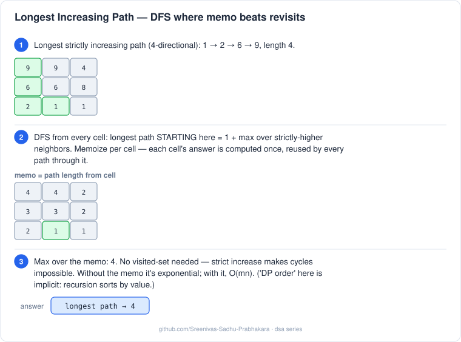

# Longest Increasing Path in a Matrix

> NeetCode 150 · 2-D DP — strictness makes the move graph a DAG, so memoized DFS needs no visited set and each cell is solved once. Go, stdlib only, tested.

## Problem

The longest path through the grid moving between 4-adjacent cells with strictly increasing values. `[[9,9,4],[6,6,8],[2,1,1]]` → 4 (1→2→6→9).

## Approach

Strictly increasing moves can never revisit a cell — the values only climb — so the implicit graph is a **DAG**, and "longest path", NP-hard in general graphs, becomes clean DP: `longest(cell) = 1 + max(longest(higher neighbor))`, memoized. Two consequences of the DAG-ness worth noticing: no visited set exists (the memo is not one — it's a cache of final answers, safe precisely because no cycle can re-enter a computation), and 0 can serve as the "unsolved" sentinel since every real answer is ≥ 1. Equal neighbors don't chain (pinned by the plateau test). Peeling by indegree (topological layers) computes the same thing iteratively.

**Complexity:** O(R·C) time — each cell solved once; O(R·C) memo.

## Visual walkthrough

Read the picture top to bottom — each numbered frame is one moment of the algorithm
running on this repo's test example.

## Run

    go test ./...   # verify
    go run .        # demo

---

Part of a 275-repo DSA series in Go — Striver's SDE Sheet (dsa-001–191) plus the NeetCode 150 / Blind 75 additions (dsa-192–275), stdlib only, every solution tested. Browse: [`dsa-*` repos](https://github.com/Sreenivas-Sadhu-Prabhakara?tab=repositories&q=dsa-&type=source).
